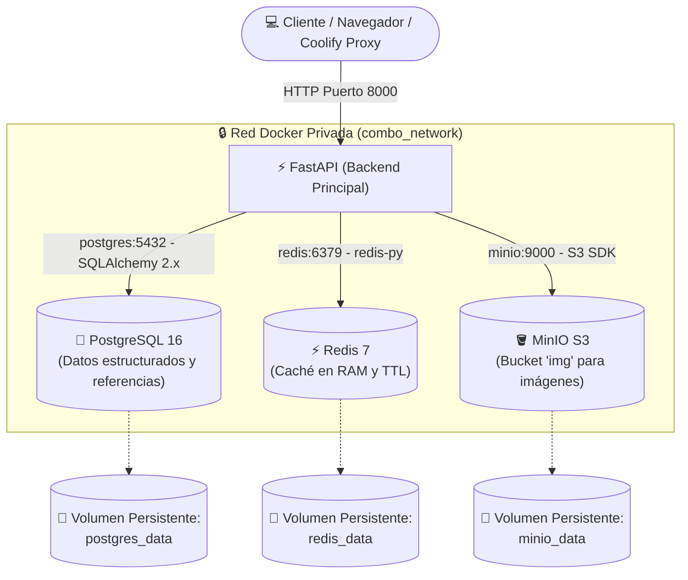
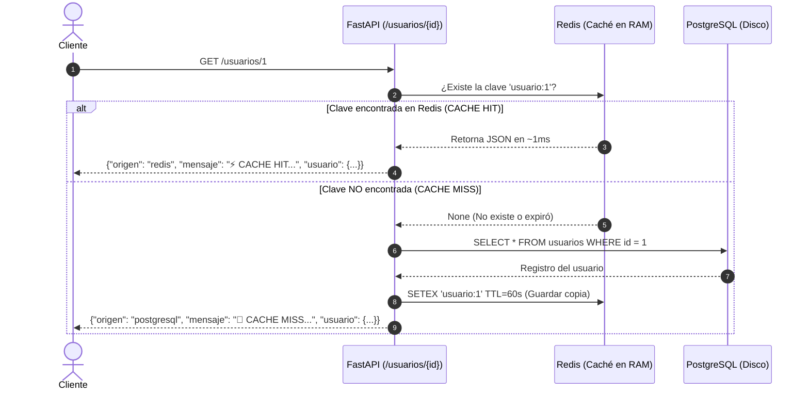

# 🚀 ComboAPI: FastAPI + PostgreSQL + Redis + MinIO en Coolify

Proyecto de ejemplo completo, modular y de nivel educativo diseñado para ilustrar la integración de **FastAPI**, **PostgreSQL (SQLAlchemy 2.x)**, **Redis** y **MinIO (S3)**, preparado para desplegarse en cualquier entorno Docker mediante un único archivo `docker-compose.yml`.

---

## 📌 Tabla de Contenidos

1. [Arquitectura del Sistema](#-arquitectura-del-sistema)
2. [Estructura Modular del Código](#-estructura-modular-del-código)
3. [Flujos Pedagógicos Explicados](#-flujos-pedagógicos-explicados)
   - [1. Persistencia con PostgreSQL y SQLAlchemy 2.x](#1-persistencia-con-postgresql-y-sqlalchemy-2x)
   - [2. Caché con Redis (CACHE HIT vs CACHE MISS)](#2-caché-con-redis-cache-hit-vs-cache-miss)
   - [3. Almacenamiento de Archivos con MinIO vs Base de Datos](#3-almacenamiento-de-archivos-con-minio-vs-base-de-datos)
4. [Despliegue en Coolify con Docker Compose](#-despliegue-en-coolify-con-docker-compose)
5. [Ejecución en Entorno Local](#-ejecución-en-entorno-local)
6. [Referencia de la API y Swagger](#-referencia-de-la-api-y-swagger)
7. [Pruebas Automatizadas](#-pruebas-automatizadas)

---

## 🏗 Arquitectura del Sistema

El proyecto implementa una red Docker privada interna (`combo_network`). La aplicación **FastAPI** actúa como el **único punto de entrada expuesto a Internet** y se encarga de orquestar de forma segura la comunicación interna con las bases de datos y el almacenamiento de objetos.



> [!IMPORTANT]
> **Seguridad por diseño:** Los servicios `postgres`, `redis` y `minio` **no tienen puertos expuestos al exterior**. Solo existen dentro de la red privada de Docker, impidiendo accesos no autorizados desde Internet.

---

## 📂 Estructura Modular del Código

A diferencia de las arquitecturas tradicionales monolíticas basadas en carpetas globales (`models/`, `schemas/`, `routers/`), este proyecto sigue el principio de **Diseño Guiado por el Dominio (Modular / Feature-Based)**.

Cada módulo funcional encapsula su propio modelo, esquemas de validación, lógica de negocio y controladores HTTP:

```text
ComboAPI/
├── docker-compose.yml       # Orquestación de los 4 servicios y volúmenes
├── Dockerfile               # Construcción de la imagen para FastAPI
├── requirements.txt         # Dependencias de producción
├── pytest.ini               # Configuración del entorno de pruebas
├── .env.example             # Plantilla de variables de entorno
├── .env                     # Variables de entorno activas
├── .dockerignore            # Exclusiones del contexto Docker
├── .gitignore               # Exclusiones de Git
├── README.md                # Documentación completa y pedagógica
├── tests/
│   └── test_api.py          # Pruebas unitarias y de integración
│
└── app/
    ├── __init__.py
    ├── main.py              # Inicialización de FastAPI, ciclo de vida (lifespan) y rutas
    │
    ├── core/                # Configuración transversal reutilizable
    │   ├── __init__.py
    │   ├── config.py        # Configuración tipada con Pydantic Settings
    │   ├── database.py      # Conexión SQLAlchemy 2.x (Engine, Base, get_db)
    │   ├── redis.py         # Cliente y conexión a Redis
    │   └── minio_client.py  # Cliente MinIO S3 e inicialización del bucket 'img'
    │
    └── modules/             # Módulos organizados por dominio
        ├── __init__.py
        │
        ├── ejemplos/        # Módulo pedagógico para comprender la infraestructura
        │   ├── __init__.py
        │   └── router.py    # Endpoints: /health, /ejemplos/postgresql, /redis, /minio
        │
        └── usuarios/        # Módulo completo de Usuarios
            ├── __init__.py
            ├── model.py     # Modelo SQLAlchemy (tabla 'usuarios')
            ├── schemas.py   # Esquemas Pydantic v2 (Create, Update, Response)
            ├── service.py   # Lógica de negocio (DB + Caché + MinIO)
            └── router.py    # Endpoints HTTP (/usuarios)
```

### ¿Cómo agregar nuevos módulos en el futuro?
Para añadir módulos como `clientes`, `productos` o `ventas`, basta con crear la carpeta correspondiente en `app/modules/`:

```text
app/modules/
├── usuarios/
├── clientes/
├── productos/
└── ventas/
```
Y registrar su router en [app/main.py](file:///home/diegolegarda/ComboAPI/app/main.py).

---

## 🧠 Flujos Pedagógicos Explicados

### 1. Persistencia con PostgreSQL y SQLAlchemy 2.x

El proyecto utiliza **SQLAlchemy 2.0 moderno**, aprovechando `DeclarativeBase`, `Mapped`, `mapped_column` y `select()`.

#### Flujo de creación de usuario:
```text
Cliente (JSON)
   ↓
FastAPI Router (POST /usuarios/)
   ↓  Valida con Pydantic (UsuarioCreate)
Service (crear_usuario)
   ↓  Verifica unicidad de email
SQLAlchemy 2.x (Session.add() + Session.commit())
   ↓  Sentencia INSERT INTO usuarios (...)
PostgreSQL 16
```

#### Modelo de la tabla `usuarios`:
- `id`: Entero autoincremental (Clave primaria).
- `nombre`: Cadena de texto (obligatoria).
- `email`: Cadena única con índice de búsqueda (obligatoria).
- `edad`: Entero (opcional).
- `imagen`: Cadena con la ruta de referencia en MinIO (ej. `usuarios/1/8f4d9f532ab34c6394d8.jpg`).
- `fecha_creacion`: Marca de tiempo UTC (`TIMESTAMP WITH TIME ZONE`).

---

### 2. Caché con Redis (CACHE HIT vs CACHE MISS)

Al consultar un usuario mediante `GET /usuarios/{id}`, la aplicación aplica el patrón **Cache-Aside**:



#### Respuesta Pedagógica Interactiva:
- En la primera llamada obtendrás:
  ```json
  {
    "origen": "postgresql",
    "mensaje": "🐘 CACHE MISS: El usuario no estaba en caché. Se consultó PostgreSQL...",
    "tiempo_vida_cache_segundos": 60,
    "usuario": { "id": 1, "nombre": "Carlos Ramírez", "email": "carlos@ejemplo.com", "edad": 28 }
  }
  ```
- En llamadas subsiguientes dentro del minuto (TTL):
  ```json
  {
    "origen": "redis",
    "mensaje": "⚡ CACHE HIT: Datos recuperados directamente desde la memoria RAM de Redis...",
    "tiempo_vida_cache_segundos": 54,
    "usuario": { "id": 1, "nombre": "Carlos Ramírez", "email": "carlos@ejemplo.com", "edad": 28 }
  }
  ```

#### Invalidación de Caché:
Si el usuario se actualiza (`PUT /usuarios/{id}`) o se elimina (`DELETE /usuarios/{id}`), la clave `usuario:{id}` en Redis se elimina de inmediato para evitar inconsistencias o datos obsoletos.

---

### 3. Almacenamiento de Archivos con MinIO vs Base de Datos

> [!TIP]
> **Buena práctica de arquitectura**: Nunca guardes archivos binarios pesados (imágenes, PDFs, videos) en columnas tipo `BLOB` o `BYTEA` dentro de PostgreSQL. Esto aumenta desmedidamente el tamaño de la base de datos, ralentiza las copias de seguridad (dumps) y satura la memoria compartida del motor relacional.

#### Flujo de Subida de Imagen (`POST /usuarios/{id}/imagen`):
```text
1. Cliente envía archivo binario multipart/form-data
   ↓
2. FastAPI valida tipo MIME (image/jpeg, image/png, image/webp)
   ↓
3. Genera un identificador único seguro (UUID):
   clave: "usuarios/1/8f4d9f532ab34c6394d8.jpg"
   ↓
4. MinIO almacena el archivo binario en el bucket 'img'
   ↓
5. PostgreSQL guarda ÚNICAMENTE la cadena de texto:
   imagen = "usuarios/1/8f4d9f532ab34c6394d8.jpg"
   ↓
6. Redis: Se invalida la caché del usuario
```

#### Flujo de Consulta de Imagen (`GET /usuarios/{id}/imagen`):
```text
Cliente
   ↓
FastAPI
   ↓
PostgreSQL (Obtiene imagen_key: "usuarios/1/8f4d9f532ab34c6394d8.jpg")
   ↓
MinIO (Descarga stream binario desde el bucket 'img')
   ↓
StreamingResponse (Transmite los chunks al cliente con el Content-Type correcto)
   ↓
Cliente visualiza la imagen directamente
```

#### Almacenamiento de Múltiples Archivos de Hoja de Vida (Bucket `archivos`):
Para documentos y anexos (`pdf`, `doc`, `docx`, `xls`, `xlsx`), el proyecto implementa un **segundo bucket independiente (`archivos`)**:
- **Relación 1 a N**: Un usuario puede tener múltiples archivos (CV en PDF, anexos en DOCX, tablas de soporte en XLSX).
- **Tabla `archivos_usuario` en PostgreSQL**: Almacena el `usuario_id`, `nombre_original`, `extension`, `content_type`, `tamano_bytes` y `archivo_key` (`hojas_de_vida/{id}/{uuid}.{ext}`).
- **Descarga con nombre legible**: Al descargar mediante `GET /usuarios/{id}/archivos/{archivo_id}`, FastAPI envía la cabecera `Content-Disposition: attachment; filename="{nombre_original}"` para que el archivo descargado conserve su nombre original y no el UUID interno.

---

## 🚢 Despliegue en Coolify con Docker Compose

Este repositorio está preparado para desplegarse en **Coolify** de forma directa:

### Paso 1: Crear nuevo recurso en Coolify
1. En tu panel de Coolify, dirígete a tu **Proyecto** y **Entorno**.
2. Haz clic en **+ New Resource** y selecciona **Docker Compose**.
3. Elige la fuente de despliegue:
   - **Git Repository**: Conecta este repositorio.
   - **Docker Compose raw**: Puedes pegar directamente el contenido de [docker-compose.yml](file:///home/diegolegarda/ComboAPI/docker-compose.yml).

### Paso 2: Configurar Variables de Entorno en Coolify
En la pestaña **Environment Variables** de Coolify, define las variables necesarias (puedes tomar como referencia [.env.example](file:///home/diegolegarda/ComboAPI/.env.example)):

```env
ENVIRONMENT=production
DEBUG=false
PROJECT_NAME="ComboAPI Producción"
PORT=8000

POSTGRES_USER=combo_user
POSTGRES_PASSWORD=tu_super_password_seguro_postgres
POSTGRES_DB=combo_db

REDIS_CACHE_TTL=60

MINIO_ROOT_USER=minio_admin
MINIO_ROOT_PASSWORD=tu_super_password_seguro_minio
MINIO_ACCESS_KEY=minio_admin
MINIO_SECRET_KEY=tu_super_password_seguro_minio
MINIO_BUCKET=img
MINIO_BUCKET_ARCHIVOS=archivos
```

### Paso 3: Asignar Dominio
En la configuración de Coolify, en la sección de Dominios:
- Asigna tu dominio o subdominio apuntando al servicio `fastapi` y puerto `8000` (ejemplo: `https://api.tudominio.com`).
- Coolify configurará automáticamente el proxy inverso (Traefik) y el certificado SSL con Let's Encrypt para FastAPI.

### Paso 4: Desplegar
Haz clic en **Deploy**. Coolify:
1. Creará la red privada `combo_network`.
2. Creará los volúmenes persistentes (`combo_postgres_data`, `combo_redis_data`, `combo_minio_data`).
3. Iniciará PostgreSQL, Redis y MinIO con sus respectivos Healthchecks.
4. Construirá y levantará el contenedor de FastAPI.
5. Verificará la salud con `/health` y enrutará el tráfico.

---

## 💻 Ejecución en Entorno Local

### Opción A: Levantar todo con Docker Compose (Recomendado)

```bash
# 1. Clonar el repositorio y entrar a la carpeta
cd ComboAPI

# 2. Copiar plantilla de variables si no existe .env
cp .env.example .env

# 3. Construir y levantar los 4 contenedores
docker compose up --build
```

Una vez levantado, abre en tu navegador:
- **API y Swagger:** [http://localhost:8000/docs](http://localhost:8000/docs)
- **Verificación de Salud:** [http://localhost:8000/health](http://localhost:8000/health)

Para detener los servicios:
```bash
docker compose down
```

---

### Opción B: Ejecución nativa con el Entorno Virtual (`.venv`)

Si deseas desarrollar localmente sobre el código Python:

```bash
# 1. Activar el entorno virtual creado
source .venv/bin/activate

# 2. Instalar dependencias
pip install -r requirements.txt

# 3. Iniciar el servidor de desarrollo
uvicorn app.main:app --reload --host 0.0.0.0 --port 8000
```

---

## 📖 Referencia de la API y Swagger

Accede a la documentación interactiva en:
```text
http://localhost:8000/docs
```

### Endpoints Principales:

| Método | Endpoint | Descripción | Servicio Primario |
| :--- | :--- | :--- | :--- |
| `GET` | `/health` | Chequeo de salud en vivo de los 4 servicios | Todos |
| `GET` | `/ejemplos/postgresql` | Explicación didáctica y estadísticas de DB | PostgreSQL |
| `GET` | `/ejemplos/redis` | Demostración de funcionamiento en memoria RAM | Redis |
| `GET` | `/ejemplos/minio` | Explicación de almacenamiento de objetos | MinIO |
| `POST` | `/usuarios/` | Crea un nuevo usuario | PostgreSQL |
| `GET` | `/usuarios/` | Lista usuarios paginados | PostgreSQL |
| `GET` | `/usuarios/{id}` | Consulta usuario con **CACHE HIT / MISS** | Redis + PostgreSQL |
| `PUT` | `/usuarios/{id}` | Actualiza usuario e invalida la caché | PostgreSQL + Redis |
| `DELETE` | `/usuarios/{id}` | Borra usuario, archivo en MinIO y caché | Todos |
| `POST` | `/usuarios/{id}/imagen` | Sube archivo a MinIO (bucket `img`) y guarda referencia | MinIO + PostgreSQL |
| `GET` | `/usuarios/{id}/imagen` | Transmite la imagen binaria desde MinIO | MinIO + PostgreSQL |
| `DELETE` | `/usuarios/{id}/imagen` | Elimina archivo de MinIO y limpia campo | MinIO + PostgreSQL |
| `POST` | `/usuarios/{id}/archivos` | Sube documento de hoja de vida (PDF, DOC, XLS) al bucket `archivos` | MinIO + PostgreSQL |
| `GET` | `/usuarios/{id}/archivos` | Lista todos los archivos y anexos del usuario | PostgreSQL |
| `GET` | `/usuarios/{id}/archivos/{archivo_id}` | Descarga archivo en streaming con su nombre original | MinIO + PostgreSQL |
| `DELETE` | `/usuarios/{id}/archivos/{archivo_id}` | Elimina el archivo físico de MinIO y su registro en PostgreSQL | MinIO + PostgreSQL |

---

## 🧪 Pruebas Automatizadas

El proyecto incluye una suite de pruebas con `pytest` que valida el CRUD, la lógica de Cache Hit/Miss, invalidaciones, gestión de múltiples documentos y los endpoints pedagógicos:

```bash
# Ejecutar los tests
./.venv/bin/pytest -v
```

Resultado esperado:
```text
tests/test_api.py::test_inicio PASSED
tests/test_api.py::test_crud_usuarios_y_cache_redis PASSED
tests/test_api.py::test_email_duplicado PASSED
tests/test_api.py::test_endpoints_pedagogicos PASSED
tests/test_api.py::test_verificar_salud PASSED
tests/test_api.py::test_subir_y_gestionar_archivos_hoja_vida PASSED
========================= 6 passed in 1.24s =========================
```

---

## 📄 Licencia

Este proyecto es de código abierto con fines pedagógicos y educativos. Siéntete libre de adaptarlo, crear nuevos módulos y utilizarlo como plantilla base para tus proyectos en Coolify.
